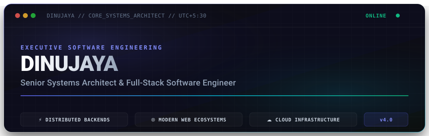
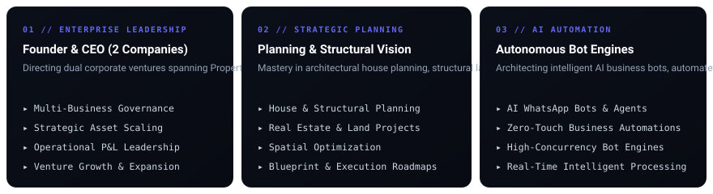

<div align="center">
  

  <br><br>

  <p align="center">
    <a href="https://donexproperty-cat.github.io" target="_blank">
      
    </a>
    &nbsp;
    <a href="mailto:donexproperty@gmail.com">
      
    </a>
    &nbsp;
    <a href="https://github.com/donexproperty-cat">
      
    </a>
  </p>
</div>

<br>

### `// 01. EXECUTIVE BRIEF`

```bash
dinujaya@systems-host:~$ sysinfo --verbose
┌───────────────────┬──────────────────────────────────────────────────────────────────┐
│ Identity          │ Dinujaya (donexproperty-cat)                                     │
│ Profession        │ Senior Systems Architect & Full-Stack Software Engineer          │
│ Core Speciality   │ High-Concurrency Distributed Backends & Modern Web Applications │
│ Location          │ Colombo, Sri Lanka (UTC +05:30)                                  │
│ Code Philosophy   │ "Sub-millisecond latency, hexagonal architectures, clean code."  │
│ Availability      │ High-Impact Architecture, Enterprise Engineering & Consultations │
└───────────────────┴──────────────────────────────────────────────────────────────────┘
```

<br>

### `// 02. SYSTEM SPECIFICATIONS & ARCHITECTURAL PILLARS`

<div align="center">
  
</div>

<br>

### `// 03. TECHNICAL ARSENAL`

<div align="center">

#### `[ CORE RUNTIMES & PROGRAMMING LANGUAGES ]`
<p>
  
  
  
  
  
  
  
  
</p>

#### `[ WEB PLATFORMS & FRAMEWORKS ]`
<p>
  
  
  
  
  
  
</p>

#### `[ CLOUD INFRASTRUCTURE, NETWORKS & TOOLING ]`
<p>
  
  
  
  
  
  
  
</p>

</div>

<br>

### `// 04. PRODUCTION ARCHITECTURAL SOLUTIONS`

<table>
  <tr>
    <td width="50%" valign="top">
      <h3>🌐 High-Scale Web Architecture</h3>
      <p>Architecting enterprise web systems with component-driven state models, modular design tokens, server-side streaming, and CDN edge optimization.</p>
      <code>Next.js • React • Tailwind • RESTful Endpoints</code>
    </td>
    <td width="50%" valign="top">
      <h3>⚡ Asynchronous Message &amp; Event Gateways</h3>
      <p>Building high-throughput real-time protocols, duplex WebSocket pipelines, concurrent read/write queues, and event-driven microservices.</p>
      <code>Node.js • WebSockets • Event Loops • Concurrency Queues</code>
    </td>
  </tr>
  <tr>
    <td width="50%" valign="top">
      <h3>☁️ Autonomous Cloud Infrastructure</h3>
      <p>Deploying hardened Linux environments, NGINX SSL reverse-proxy topologies, automated self-healing process daemons, and zero-trust private tunneling.</p>
      <code>Linux / Ubuntu • NGINX • PM2 • WireGuard • SSL Hardening</code>
    </td>
    <td width="50%" valign="top">
      <h3>📱 Native-Performance Mobile Systems</h3>
      <p>Cross-platform application design utilizing Flutter &amp; Dart engines for unified Android &amp; iOS deployment with synchronized cloud data pipelines.</p>
      <code>Flutter • Dart • Native Bridges • Real-Time Sync</code>
    </td>
  </tr>
</table>

<br>

### `// 05. TELEMETRY & METRICS`

<div align="center">
  <p align="center">
    
    
  </p>
</div>

<br>

---

<div align="center">
  <p>
    <b>DINUJAYA</b> // <i>Senior Systems Architect &amp; Software Engineer</i><br>
    <a href="https://donexproperty-cat.github.io">Executive Portfolio</a> &nbsp;•&nbsp; 
    <a href="mailto:donexproperty@gmail.com">donexproperty@gmail.com</a> &nbsp;•&nbsp; 
    <a href="https://github.com/donexproperty-cat">GitHub Core</a>
  </p>
  <sub>Designed with architectural precision, luxury minimalist aesthetics, and mathematical rigor.</sub>
</div>
