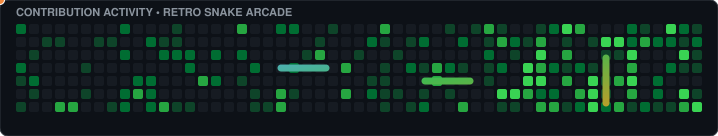

<div align="center">
  

  <a href="https://github.com/donexproperty-cat">
    
  </a>

  <p align="center">
    <a href="https://donexproperty-cat.github.io">
      
    </a>
  </p>

  <p align="center">
    
    
    
  </p>
</div>

---

### 👨‍💻 About Me

```yaml
user: Dinujaya
alias: donexproperty-cat
profession: Full-Stack Developer | Systems & Cloud Architect
passion: High-concurrency bots, automated backends, scalable architecture
working_on:
  - Enterprise WhatsApp automation frameworks (Multi-Session, WebSocket, Baileys)
  - Dedicated Cloud / VPS deployment clusters & secure network tunneling
  - Modern web applications & full-stack platforms
philosophy: "Automate everything, optimize for performance, craft with precision."
```

---

### 🚀 Featured Systems & Flagship Architectures

<table>
  <tr>
    <td width="50%" valign="top">
      <h3 align="center">🏛️ Dinujaya Enterprise Engine</h3>
      <p align="center">
        
        
        
        
      </p>
      <ul>
        <li><b>High-concurrency WhatsApp bot system</b> with multi-session auth.</li>
        <li>Real-time read/write queue handling thousands of concurrent interactions safely.</li>
        <li>Automated slip processing, live web admin portal, and customer hub.</li>
      </ul>
    </td>
    <td width="50%" valign="top">
      <h3 align="center">⚡ Cloud VPS Orchestration</h3>
      <p align="center">
        
        
        
        
      </p>
      <ul>
        <li>Autonomous <b>VPS cloud cluster</b> running isolated developer studios.</li>
        <li>Reverse proxy setups, SSL automation, automated crontab backups.</li>
        <li>Low-latency private VPN tunneling for secure remote operations.</li>
      </ul>
    </td>
  </tr>
  <tr>
    <td width="50%" valign="top">
      <h3 align="center">🌐 DONEX Web Platform</h3>
      <p align="center">
        
        
        
        
      </p>
      <ul>
        <li>Modern property showcase and business web portal.</li>
        <li>Interactive, responsive UI with high-performance asset loading.</li>
        <li>Designed with architectural precision and clean code aesthetics.</li>
      </ul>
    </td>
    <td width="50%" valign="top">
      <h3 align="center">📱 Cross-Platform Mobile Solutions</h3>
      <p align="center">
        
        
        
        
      </p>
      <ul>
        <li>Real-time data visualization and management mobile applications.</li>
        <li>Responsive layouts, smooth UI animations, and native performance.</li>
        <li>Seamless REST and WebSocket backend synchronization.</li>
      </ul>
    </td>
  </tr>
</table>

---

### 🛠️ Tech Stack & Arsenal

<div align="center">

#### 💻 Programming Languages
<p>
  
  
  
  
  
  
  
  
  
</p>

#### 🌐 Frameworks & Technologies
<p>
  
  
  
  
  
</p>

#### ⚙️ Cloud, DevOps, Networks & Tools
<p>
  
  
  
  
  
  
  
  
  
</p>

</div>

---

### 🐍 Contribution Activity & Retro Snake Arcade

<div align="center">
  
</div>

---

### 📊 Real-Time GitHub Analytics & Summaries

<div align="center">
  <p align="center">
    
    
  </p>
  <p align="center">
    
    
  </p>
</div>

---

### 💡 Daily Developer Inspiration

<div align="center">
  
</div>

---

### 🤝 Get in Touch & Connect

<div align="center">
  <a href="https://donexproperty-cat.github.io" target="_blank">
    
  </a>
  <a href="https://github.com/donexproperty-cat">
    
  </a>
  <a href="mailto:donexproperty@gmail.com">
    
  </a>
  <a href="https://github.com/donexproperty-cat/DONEX">
    
  </a>
</div>

<br />

<div align="center">
  
</div>